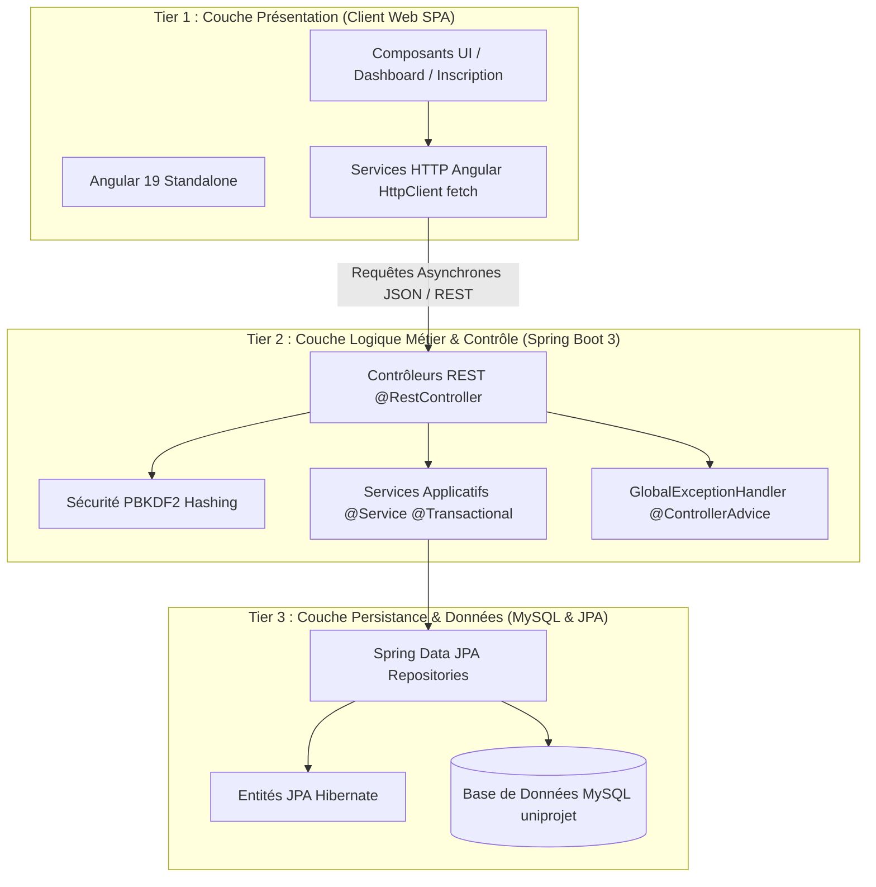
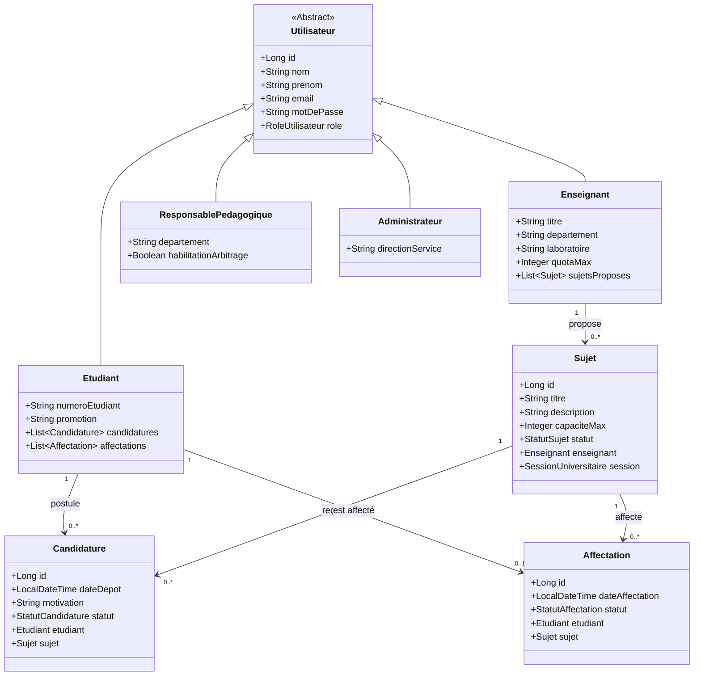

# UNIVERSITÉ GASTON BERGER DE SAINT-LOUIS (UGB)
## UFR des Sciences Appliquées et de Technologie (UFR SAT)
### Département d'Informatique — Master 2 Génie du Développement Informatique et Logiciel (GDIL)

---

# RAPPORT DE PROJET PRATIQUE
## DÉVELOPPEMENT D'APPLICATIONS MULTI-TIERS

**Sujet :** Conception et Développement d'une Application Web Multi-Tiers de Gestion des Projets Tutorés (« UniProjet »)  
**Année Universitaire :** 2024 - 2025  
**Document Word officiel généré :** [`Rapport_Projet_Tutores_M2_GDIL.docx`](file:///c:/Users/bmd/Documents/Spring/Rapport_Projet_Tutores_M2_GDIL.docx)

---

## Sommaire
1. [Fiche Synthétique & Résumé Exécutif](#fiche-synthétique--résumé-exécutif)
2. [Chapitre 1 : Analyse des Besoins et Spécifications Fonctionnelles](#chapitre-1--analyse-des-besoins-et-spécifications-fonctionnelles)
   - 1.1 Contexte et Problématique
   - 1.2 Identification des Acteurs et Rôles
   - 1.3 Règles Métier Obligatoires
3. [Chapitre 2 : Architecture Multi-Tiers et Conception Technique](#chapitre-2--architecture-multi-tiers-et-conception-technique)
   - 2.1 Vue d'Ensemble de l'Architecture 3-Tiers
   - 2.2 Modèle Conceptuel et Diagramme de Classes UML
   - 2.3 Conception des Points de Terminaison de l'API RESTful
   - 2.4 Sécurité et Chiffrement PBKDF2
4. [Chapitre 3 : Réalisation et Implémentation Logicielle](#chapitre-3--réalisation-et-implémentation-logicielle)
   - 3.1 Backend Spring Boot 3 & Spring Data JPA
   - 3.2 Frontend Angular Standalone & Navigation Adaptative
5. [Chapitre 4 : Preuves Visuelles des Travaux Réalisés (Captures d'écran commentées)](#chapitre-4--preuves-visuelles-des-travaux-réalisés)
   - 4.1 Espace Étudiant
   - 4.2 Espace Enseignant / Encadrant
   - 4.3 Espace Responsable Pédagogique (Commission d'Arbitrage)
   - 4.4 Espace Administration Système
6. [Chapitre 5 : Validation, Tests et Déploiement](#chapitre-5--validation-tests-et-déploiement)
   - 5.1 Scénarios de Test de Bout en Bout
   - 5.2 Comptes de Démonstration Pré-configurés (UGB)
7. [Conclusion Générale et Perspectives](#conclusion-générale-et-perspectives)

---

## Fiche Synthétique & Résumé Exécutif

Ce rapport technique formalise la conception, la modélisation et la réalisation logicielle complète de la plateforme web académique **UniProjet**, dédiée à la gestion intégrale du cycle de vie des projets tutorés au sein de l'Université Gaston Berger (UGB).

Conformément au cahier des charges du **Master 2 GDIL**, la solution respecte rigoureusement une séparation stricte des couches dans le cadre d'une architecture multi-tiers (3-Tiers) :
- **Couche Présentation (Frontend) :** Application Single Page (SPA) développée sous le framework **Angular**, s'appuyant sur des composants autonomes (*Standalone Components*), Bootstrap 5, un design responsive, une barre latérale (*Sidebar*) dynamique et adaptative selon le rôle, et un formulaire d'inscription complet.
- **Couche Logique Métier (Backend) :** API RESTful JSON articulée autour du framework **Spring Boot 3** et de services applicatifs garantissant les règles d'intégrité métier (unicité de candidature, contrôle des quotas d'encadrement, arbitrage collégial).
- **Couche Persistance (Données) :** Mapping objet-relationnel fondé sur **Spring Data JPA** et **Hibernate**, adossé à un système de gestion de base de données relationnelle **MySQL** normalisé.
- **Sécurité & Authentification :** Mécanisme de hachage de mot de passe renforcé par **PBKDF2 avec sel cryptographique aléatoire de 128 bits et 65 536 itérations**, doublé d'un contrôle d'accès basé sur les rôles (RBAC).

---

## Chapitre 1 : Analyse des Besoins et Spécifications Fonctionnelles

### 1.1 Contexte et Problématique
Chaque année universitaire, l'organisation des projets tutorés représente une charge administrative et pédagogique considérable pour le département informatique. Les démarches traditionnelles (formulaires papier, échanges d'e-mails dispersés, fichiers tableurs non synchronisés) engendrent de multiples difficultés :
- Perte d'informations et redondance des dépôts de sujets par les enseignants-chercheurs ;
- Opacité dans le suivi des candidatures et sentiments d'arbitraire chez les étudiants ;
- Dépassement involontaire des quotas d'encadrement par laboratoire ou encadrant ;
- Complexité extrême pour la Commission Pédagogique lors de la phase d'arbitrage et d'affectation définitive des binômes.

L'application **UniProjet** répond à cette problématique en fournissant une solution unifiée, collaborative, réactive et sécurisée.

### 1.2 Identification des Acteurs et Rôles

| Rôle | Acteur | Responsabilités et Actions Clés |
| :--- | :--- | :--- |
| **ETUDIANT** | Étudiant inscrit en M2 | Consulter le catalogue des sujets disponibles, postuler avec vœu motivé, suivre l'état de validation de ses candidatures, consulter son affectation finale. |
| **ENSEIGNANT** | Enseignant-Chercheur / Tuteur | Proposer de nouveaux sujets de recherche/développement, éditer ou retirer ses sujets, consulter les dossiers des candidats et émettre un avis d'encadrement. |
| **RESPONSABLE** | Responsable Pédagogique / Commission | Consulter l'ensemble des vœux, arbitrer collégialement les candidatures (Accepter / Rejeter), veiller au strict respect des quotas et affecter définitivement les étudiants. |
| **ADMIN** | Administrateur Système / ENT | Gérer l'annuaire des étudiants et enseignants, superviser la campagne, configurer les sessions universitaires et auditer les accès système. |

### 1.3 Règles Métier Obligatoires
Pour satisfaire les exigences formelles énoncées dans le sujet pratique, la couche métier du backend implémente cinq règles de gestion cardinales :
1. **Règle RM-01 (Candidature unique) :** Un étudiant ne peut postuler qu'une seule fois à un même sujet de projet tutoré. Toute tentative de doublon déclenche une exception HTTP 400 (*Bad Request*).
2. **Règle RM-02 (Disponibilité stricte) :** Seuls les sujets dont le statut est explicitement `DISPONIBLE` peuvent recevoir de nouvelles candidatures. Un sujet marqué `COMPLET` est verrouillé.
3. **Règle RM-03 (Machine à états des candidatures) :** Toute nouvelle candidature naît au statut `EN_ATTENTE`. Seul le responsable pédagogique peut la faire transiter vers `ACCEPTEE` ou `REJETEE`.
4. **Règle RM-04 (Plafond de capacité d'accueil) :** Chaque sujet définit une capacité maximale d'accueil (ex: 2 à 3 étudiants). Dès que le nombre de candidatures acceptées atteint ce plafond, le sujet passe automatiquement en statut `COMPLET`.
5. **Règle RM-05 (Affectation définitive automatique) :** Lorsqu'une candidature est acceptée par la commission, une instance d'affectation officielle est automatiquement créée et liée à l'étudiant et au sujet.

---

## Chapitre 2 : Architecture Multi-Tiers et Conception Technique

### 2.1 Vue d'Ensemble de l'Architecture 3-Tiers

### 2.2 Diagramme de Classes UML (Modèle de Domaine)

### 2.3 Conception des Points de Terminaison de l'API RESTful

| Méthode HTTP | Endpoint REST | Description & Règles Associées |
| :--- | :--- | :--- |
| `POST` | `/api/utilisateurs/connexion` | Authentification avec email/mot de passe et vérification du hash PBKDF2 |
| `POST` | `/api/utilisateurs/inscription` | Inscription dynamique (Étudiant ou Enseignant) avec validation de formulaire |
| `GET` | `/api/sujets` | Liste de tous les sujets de projets tutorés |
| `GET` | `/api/sujets/disponibles` | Liste des sujets disponibles (places restantes > 0) |
| `POST` | `/api/sujets` | Création d'un nouveau sujet de projet tutoré |
| `PUT` | `/api/sujets/{id}` | Modification d'un sujet (titre, capacité, description) |
| `DELETE` | `/api/sujets/{id}` | Suppression d'un sujet |
| `GET` | `/api/candidatures` | Consultation de toutes les candidatures pour arbitrage |
| `POST` | `/api/candidatures` | Dépôt d'une candidature (contrôle candidature unique RM-01) |
| `PUT` | `/api/candidatures/{id}/statut` | Arbitrage du statut (ACCEPTEE / REJETEE) et mise à jour de la capacité |
| `GET` | `/api/affectations` | Consultation du registre synthétique des affectations |

### 2.4 Sécurité et Chiffrement PBKDF2
La classe `SecuriteUtilitaire` implémente le standard cryptographique **PBKDF2** (*Password-Based Key Derivation Function 2*) :
- Algorithme : `PBKDF2WithHmacSHA256` ;
- Sel pseudo-aléatoire cryptographique : 16 octets (128 bits) via `SecureRandom` ;
- Facteur d'itération : 65 536 itérations ;
- Format d'encodage persistant : `selBase64:hashBase64`.

---

## Chapitre 3 : Réalisation et Implémentation Logicielle

### 3.1 Backend Spring Boot 3
- **Services Transactionnels :** Gestion des règles métier avec `@Transactional` garantissant la cohérence en cas d'erreur.
- **Gestionnaire Global d'Exceptions :** Un `@ControllerAdvice` intercepte les `IllegalArgumentException` pour retourner des messages d'erreur clairs et un code HTTP `400 Bad Request`.
- **Comptes Démo UGB :** `DataInitializer` peuple automatiquement la base de données au démarrage avec des comptes réalistes du domaine sénégalais `@ugb.edu.sn`.

### 3.2 Frontend Angular Standalone
- **Composants Standalone :** Architecture moderne Angular sans `NgModules`.
- **Sidebar Dynamique & Déconnexion :** La barre latérale s'adapte en temps réel au rôle de l'utilisateur connecté via `AuthService` et offre un bouton de déconnexion direct qui réinitialise la session locale et redirige vers l'accueil.
- **Formulaire d'Inscription :** Route `/inscription` permettant à tout nouvel utilisateur de se créer un compte avec détection automatique de profil (étudiant ou enseignant).

---

## Chapitre 4 : Preuves Visuelles des Travaux Réalisés

### 4.1 Espace Étudiant
- **Tableau de Bord Étudiant :** Indicateurs synthétiques (24 sujets disponibles, 3 candidatures déposées, 1 acceptée) et flux des dernières propositions.
- **Catalogue des Sujets :** Moteur de recherche instantané, filtres technologiques, jauges de capacité restantes et bouton de candidature.
- **Suivi des Candidatures :** Visualisation claire des statuts `EN_ATTENTE`, `ACCEPTEE`, `REJETEE`.

### 4.2 Espace Enseignant / Encadrant
- **Tableau de Bord Enseignant :** Vue d'ensemble des propositions, quotas de places (8 ouvertes, 6 dossiers reçus).
- **Gestion des Sujets :** Formulaire complet d'ajout/modification avec définition du quota maximal d'étudiants.
- **Examen des Candidatures :** Consultation des profils et avis pédagogique pour la commission.

### 4.3 Espace Responsable Pédagogique (Commission d'Arbitrage)
- **Tableau de Bord de la Commission :** Synthèse globale (42 dossiers, 5 en attente d'arbitrage, 28 affectations confirmées, 9 réorientations).
- **Interface d'Arbitrage :** Décision immédiate via les boutons `Accepter` et `Rejeter`.
- **Registre des Affectations :** Tableau récapitulatif des binômes affectés et du taux de remplissage des laboratoires (LIRIS, CRAN, etc.).

### 4.4 Espace Administration Système
- **Supervision Générale :** Suivi de 142 étudiants, 24 encadrants et 94 vœux.
- **Annuaire des Étudiants :** Gestion des numéros étudiants, parcours M2 et statut des comptes ENT.
- **Annuaire des Enseignants :** Gestion des laboratoires, départements et suivi des quotas d'encadrement.

---

## Chapitre 5 : Validation, Tests et Déploiement

### 5.1 Scénarios de Test de Bout en Bout

| N° Test | Scénario de Test | Comportement Attendu | Résultat Observé |
| :--- | :--- | :--- | :--- |
| **T-01** | Connexion avec identifiants UGB valides | Redirection vers le dashboard adapté avec menu latéral contextuel | **SUCCÈS (200 OK)** |
| **T-02** | Tentative de connexion avec mot de passe erroné | Refus d'accès sécurisé avec code HTTP 401 | **SUCCÈS (401)** |
| **T-03** | Création de compte étudiant via `/inscription` | Création en base MySQL avec hachage PBKDF2 | **SUCCÈS (201 Created)** |
| **T-04** | Proposition de sujet par un enseignant | Persistance immédiate avec statut DISPONIBLE | **SUCCÈS (200 OK)** |
| **T-05** | Dépôt d'une candidature par un étudiant | Création au statut EN_ATTENTE | **SUCCÈS (200 OK)** |
| **T-06** | Tentative de double candidature sur le même sujet | Rejet strict avec HTTP 400 Bad Request (Règle RM-01) | **SUCCÈS (400 Rejet)** |
| **T-07** | Arbitrage positif par le Responsable Pédagogique | Statut passe à ACCEPTEE, Affectation créée, quota décrémenté | **SUCCÈS (200 OK)** |
| **T-08** | Saturation de la capacité maximale d'un sujet | Bascule automatique au statut COMPLET | **SUCCÈS (RM-04 Validée)** |
| **T-09** | Déconnexion via le bouton de la sidebar | Nettoyage du localStorage et redirection accueil | **SUCCÈS (Session close)** |

### 5.2 Comptes de Démonstration Pré-configurés (UGB)
*Mot de passe universel : `Passer123!`*

| Rôle | Nom & Prénom | Email Académique UGB |
| :--- | :--- | :--- |
| **ETUDIANT** | Badji Alioune Badara | `badji.alioune-badara@ugb.edu.sn` |
| **ETUDIANT** | Fall Fatou | `fall.fatou@ugb.edu.sn` |
| **ENSEIGNANT** | Dr. Diop Moussa | `diop.moussa@ugb.edu.sn` |
| **RESPONSABLE** | Dr. Sow Aminata | `sow.aminata@ugb.edu.sn` |
| **ADMIN** | Administrateur UGB | `admin.ugb@ugb.edu.sn` |

---

## Conclusion Générale et Perspectives

Le projet pratique **UniProjet** démontre l'application concrète des concepts avancés du **Master 2 GDIL** :
- Séparation rigoureuse et éprouvée entre la présentation (Angular), la logique métier (Spring Boot) et la persistance (Spring Data JPA / MySQL) ;
- Vérification systématique des règles métier au niveau de la couche de services ;
- Sécurité renforcée avec hachage PBKDF2 et contrôle d'accès par rôle ;
- Interface utilisateur fluide, dynamique et réactive avec sidebar contextuelle et formulaires validés.
